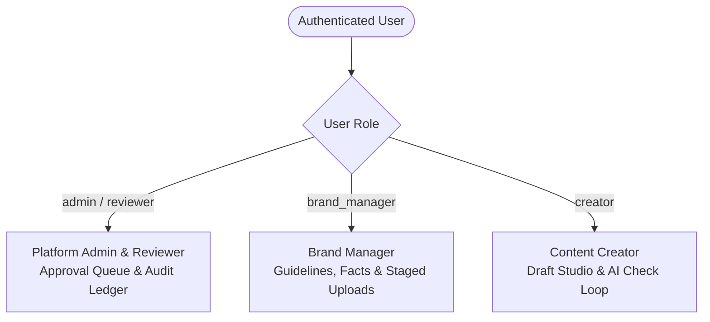

# BrandDNA — AI-Powered Brand Governance Platform

> *"Protecting the identity behind every brand message."*

**BrandDNA** is an enterprise brand governance and compliance platform designed to help organisations maintain a unified, trustworthy, and consistent brand identity. It acts as an intelligent pre-publication checkpoint, checking marketing content, social media captions, brochures, and visual creatives against approved brand guidelines, verified facts, current pricing, tone-of-voice directives, and terminology rules before publication.

This repository contains the **React Single-Page Application (SPA)** frontend built with **Vite** and **Tailwind CSS**.

---

## Table of Contents

1. [Features](#1-features)
   - [Completed Features](#completed-features)
   - [Planned & Future Features](#planned--future-features)
2. [Technology Stack](#2-technology-stack)
3. [Project Structure](#3-project-structure)
4. [Prerequisites and Installation](#4-prerequisites-and-installation)
   - [Prerequisites](#prerequisites)
   - [Local Setup](#local-setup)
   - [Available Scripts](#available-scripts)
5. [Environment Variables and Backend Connection](#5-environment-variables-and-backend-connection)
6. [User Roles and Workflows](#6-user-roles-and-workflows)
   - [1. Brand Manager](#1-brand-manager)
   - [2. Content Creator / Marketing Team](#2-content-creator--marketing-team)
   - [3. Platform Admin / Reviewer](#3-platform-admin--reviewer)
   - [Demo Quick-Login Accounts](#demo-quick-login-accounts)
7. [Screenshots and Visual Demo](#7-screenshots-and-visual-demo)
8. [Development Guidelines](#8-development-guidelines)
9. [Testing and Troubleshooting](#9-testing-and-troubleshooting)
10. [Future Improvements](#10-future-improvements)
11. [Contribution and License](#11-contribution-and-license)

---

## 1. Features

### Completed Features

- **Authentication & Role-Based Access Control (RBAC):**
  - Secure registration and login using JWT tokens stored in `localStorage`.
  - Protected client-side routing (`<ProtectedRoute />`) ensuring users only access authorized portals based on their backend-assigned role.
  - Automatic session expiration handling (Axios interceptor catches `401` errors, clears stored tokens, and redirects to `/login`).
  - Public registration restricted to `creator` and `brand_manager` roles; privileged roles (`admin`, `reviewer`) cannot be self-assigned.
  - **1-Click Role Switcher**: Demo pills on the login page to immediately test the platform across Admin, Reviewer, Brand Manager, and Creator personas.

- **Role-Dedicated Dashboards:**
  - **Brand Manager Dashboard (`/brand-manager/dashboard`):** High-level view of brand workspaces, guideline rule counts, verified pricing facts, tone-of-voice attributes, and recent review activity.
  - **Content Creator Studio (`/creator/dashboard`):** 6-state workflow KPI tracker (Drafts, Under AI Review, Needs Changes, Pending Approval, Approved, Rejected), search filters, and submission history table.
  - **Platform Admin Dashboard (`/admin/dashboard`):** Live database statistics (total users, brands, submissions, pending sign-offs, approvals, rejections), recurring violation analytics, user directory, and recent activity feed.
  - **Authorized Approval Queue (`/review-queue`):** Dedicated inbox for Platform Admins and Reviewers to inspect pending submissions and issue formal sign-offs.

- **Brand Knowledge Base & Guideline Management (`/brands`, `/brands/:id`):**
  - Create, view, edit, and archive isolated brand workspaces with industry, website, and hex color tags.
  - Full management of **Brand Guidelines** categorized by `tone`, `messaging`, `visual`, `terminology`, `compliance`, and `general` with severity tags (`critical`, `warning`, `info`).
  - Full management of **Approved Facts Database** (e.g., subscription pricing, product specifications, legal claims) serving as the ground-truth comparison source.
  - Full management of **Terminology Rules** (mandating preferred alternatives over prohibited vocabulary with explanatory rationale).
  - Brand Asset Library (`/brand-manager/assets`) for storing official logos, colors, fonts, and creative assets.

- **Document Ingestion & Staged Candidate Extraction (`/brand-manager/uploads`):**
  - Upload official brand guideline documents (`.pdf`, `.docx`, `.txt`).
  - Staged candidate rule review: parsed rules are held in a `pending` state until the Brand Manager reviews, edits, and explicitly **Approves** or **Rejects** them into the official knowledge base.

- **Multi-Format Content Submission Studio (`/reviews/new`):**
  - Clean text editor for marketing copy, ad copy, emails, and social captions.
  - Drag-and-drop file upload supporting **multiple files simultaneously**.
  - Supported formats: **PDF documents**, **Word documents (`.docx`, `.doc`)**, **Plain Text (`.txt`, `.md`)**, and **Marketing Images (`.png`, `.jpg`, `.jpeg`, `.webp`)** up to 15MB each.
  - Selected file queue with file-type badges, formatted file sizes, thumbnail previews for images, and removal controls.
  - **1-Click "Load NovaFit Test Scenario"** button to instantly populate canonical test content with known pricing, tone, and promotional claim violations.

- **Interactive Compliance Diagnostics & Review Details (`/reviews/:id`):**
  - Real-time overall compliance score calculation (0–100 scale).
  - Diagnostic finding cards displaying:
    - Problematic text or visual element highlighted.
    - Category tag and severity badge (`critical`, `warning`, `info`).
    - Source file badge (e.g., `newsletter_draft.txt` or `brochure.pdf`) and document location metadata.
    - Detailed explanation citing the exact brand rule or approved fact violated.
    - Official evidence source citation.
    - **1-Click "Apply" Correction:** Automatically replaces the flagged text directly in the draft revision editor.
  - Extracted text modal to inspect raw content parsed from uploaded PDFs and DOCX files.
  - Image lightbox modal for full-screen inspection of uploaded creative assets.

- **Versioned Content Revisions & Governance Workflow:**
  - In-place revision editor to modify text copy and attach replacement files.
  - Preserves complete historical version snapshots (v1, v2, v3, etc.) without overwriting original drafts.
  - **Human-in-the-Loop Sign-off**: Content Creators are restricted from self-approving their own submissions (`HTTP 403 Forbidden`).
  - Authorized Reviewers can **Approve**, **Reject**, or **Request Changes** with mandatory feedback notes.
  - Full discussion comment thread on every review record for creator-reviewer collaboration.
  - Detailed immutable audit trail displaying every status change, timestamp, and actor.

- **User & Platform Administration (`/admin/users`, `/admin/audit-logs`):**
  - **User & Role Management (`/admin/users`):** View registered users, update roles (`admin`, `reviewer`, `brand_manager`, `creator`), toggle active/suspended status, and assign brand workspace permissions.
  - **Platform Audit Ledger (`/admin/audit-logs`):** Filterable, append-only ledger tracking role modifications, guideline changes, document extractions, and review decisions.
  - **System Notifications (`/notifications`):** Alert inbox with unread filters, mark-as-read toggles, and direct links to related reviews.

- **Responsive UI & Design System:**
  - Modern, accessible user interface built with Tailwind CSS.
  - Curated navy and teal palette (`#0f766e`, `#102a43`, `#f8fafc`).
  - Responsive layouts supporting desktop, tablet, and mobile displays.

---

### Planned & Future Features

The following items represent potential roadmap extensions:
- [ ] Exportable PDF compliance certificates and review audit receipts.
- [ ] Figma canvas plugin integration for real-time asset governance.
- [ ] Optical Character Recognition (OCR) fallback for low-resolution scanned image PDFs without selectable text.
- [ ] WebSocket-based real-time push alerts for concurrent multi-user editing.
- [ ] Automated CMS publishing hooks (e.g. WordPress, Contentful) to gate publishing pipelines.

---

## 2. Technology Stack

The BrandDNA frontend relies strictly on the following installed dependencies:

| Category | Technology | Version | Purpose in Codebase |
| :--- | :--- | :--- | :--- |
| **Framework** | [React](https://react.dev/) | `^18.3.1` | Core declarative UI component model and virtual DOM rendering |
| **DOM Renderer** | [React DOM](https://react.dev/) | `^18.3.1` | React entry point mounting into `index.html` |
| **Build Tool & Bundler** | [Vite](https://vitejs.dev/) | `^6.0.7` | Fast ES-module development server and production bundler |
| **Vite React Plugin** | [@vitejs/plugin-react](https://github.com/vitejs/vite-plugin-react) | `^4.3.4` | Babel-based Fast Refresh and JSX transformation support |
| **Routing** | [React Router DOM](https://reactrouter.com/) | `^6.28.2` | Single-page application routing, protected route guards, URL parameters |
| **Styling Framework** | [Tailwind CSS](https://tailwindcss.com/) | `^3.4.17` | Utility-first CSS framework with custom theme extensions |
| **CSS Preprocessing** | [PostCSS](https://postcss.org/) & [Autoprefixer](https://github.com/postcss/autoprefixer) | `^8.4.49` / `^10.4.20` | CSS transformation, vendor prefixing, and Tailwind compilation |
| **Icons** | [Lucide React](https://lucide.dev/) | `^0.474.0` | Comprehensive SVG icon library used across dashboards and actions |
| **HTTP Client** | [Axios](https://axios-http.com/) | `^1.7.9` | Promise-based HTTP client with request and response interceptors |
| **Toast Notifications** | [React Hot Toast](https://react-hot-toast.com/) | `^2.5.1` | Lightweight, non-blocking toast notifications for user actions |
| **Typography** | [Google Fonts](https://fonts.google.com/) | Web Fonts | Plus Jakarta Sans (primary UI typeface) & JetBrains Mono (monospaced code/rules) |

---

## 3. Project Structure

```text
frontend/
├── .env.example               # Template for client-side environment variables
├── index.html                 # HTML application entry point with font links and favicon
├── package.json               # Dependencies, build scripts, and project metadata
├── package-lock.json          # Deterministic dependency lockfile
├── postcss.config.js          # PostCSS configuration loading Tailwind CSS and Autoprefixer
├── tailwind.config.js         # Tailwind theme extension (custom navy, teal, fonts)
├── vite.config.js             # Vite configuration with port 3000 and /api reverse proxy
├── dist/                      # Production build output directory (generated on build)
└── src/
    ├── App.jsx                # Application route registry, RBAC wrappers, and layout shell
    ├── index.css              # Tailwind base/component directives and custom scrollbars
    ├── main.jsx               # Client bootstrap mounting App into BrowserRouter & AuthProvider
    ├── api/                   # Centralized Axios API client services
    │   ├── admin.js           # Platform statistics, user management, and audit log endpoints
    │   ├── auth.js            # Login, registration, and session verification endpoints
    │   ├── brands.js          # Brand CRUD, asset library, and document extraction endpoints
    │   ├── client.js          # Configured Axios instance with JWT bearer and error interceptors
    │   ├── comments.js        # Review thread discussion endpoints
    │   ├── facts.js           # Brand approved facts and pricing endpoints
    │   ├── guidelines.js      # Brand guidelines and compliance rules endpoints
    │   ├── notifications.js   # User notification inbox and mark-as-read endpoints
    │   ├── reviews.js         # Review creation, multi-format audit, and workflow endpoints
    │   └── terminology.js     # Approved and prohibited terminology endpoints
    ├── components/            # Reusable UI presentation components
    │   ├── ConfirmDialog.jsx  # Reusable confirmation modal for archive and delete actions
    │   ├── EmptyState.jsx     # Consistent empty-state placeholder card with optional action
    │   ├── ErrorState.jsx     # Error display card with automated retry handler
    │   ├── LoadingState.jsx   # Centered animated spinner with context message
    │   ├── Navbar.jsx         # Sticky top navigation bar with unread alert badge & user profile
    │   ├── ProtectedRoute.jsx # Route authentication and role-authorization wrapper
    │   ├── ReviewFinding.jsx  # Card displaying finding severity, file source, and suggestions
    │   ├── Sidebar.jsx        # Role-filtered vertical navigation sidebar
    │   └── StatusBadge.jsx    # Formatted status badges for review states and severities
    ├── context/               # Global state providers
    │   └── AuthContext.jsx    # Authentication state, JWT persistence, and role helper methods
    ├── layouts/               # Page layout shells
    │   └── AppLayout.jsx      # Authenticated layout integrating Navbar, Sidebar, and content
    └── pages/                 # Full application page views
        ├── AdminAuditLogs.jsx        # Platform audit trail and activity ledger
        ├── AdminDashboard.jsx        # Platform Admin metrics, users, and review queue
        ├── AdminUsers.jsx            # User management, role changes, and account toggling
        ├── BrandDetails.jsx          # Multi-tab brand workspace (Rules, Facts, Terminology)
        ├── BrandManagerAssets.jsx    # Asset library for brand logos, colors, and imagery
        ├── BrandManagerDashboard.jsx # Brand Manager overview, stats, and rule shortcuts
        ├── BrandManagerUploads.jsx   # PDF guideline document upload and staged extraction
        ├── Brands.jsx                # Brand workspace directory and brand creation modal
        ├── CreateReview.jsx          # Multi-format content check studio (PDF, DOCX, TXT, IMG)
        ├── CreatorDashboard.jsx      # Content Creator dashboard with 6-stage workflow KPIs
        ├── Dashboard.jsx             # Dynamic routing hub redirecting users to their role view
        ├── Login.jsx                 # User login screen with 1-click judge demo accounts
        ├── NotFound.jsx              # Custom 404 page for unmatched routes
        ├── Notifications.jsx         # System alert inbox with filter and read toggles
        ├── Register.jsx              # User registration screen supporting Creator or Manager
        ├── ReviewDetails.jsx         # Comprehensive audit diagnostic, files, and approval actions
        ├── ReviewQueue.jsx           # Reviewer queue of submissions pending human decision
        └── Reviews.jsx               # Filterable directory of all content submissions
```

---

## 4. Prerequisites and Installation

### Prerequisites

Ensure the following tools are installed on your workstation:
- **Node.js:** `v18.0.0` or higher (tested on Node `v24.x`).
- **npm:** `v9.0.0` or higher.
- A running instance of the **BrandDNA Backend** (e.g. deployed at `https://branddna-tup9.onrender.com` or local backend).

### Local Setup

1. **Navigate to the frontend directory:**
   ```bash
   cd "D:\Antigravity projects\codexhackothon\BrandDNA\frontend"
   ```

2. **Install project dependencies:**
   ```bash
   npm install
   ```

3. **Configure the environment file:**
   Create a local `.env` file from the provided template:
   ```bash
   cp .env.example .env
   ```

4. **Start the local development server:**
   ```bash
   npm run dev
   ```
   The Vite development server will start at:
   - **Local URL:** `http://localhost:3000`
   - **Network URL:** `http://<your-local-ip>:3000`

5. **Create an optimized production build:**
   ```bash
   npm run build
   ```
   Production-ready bundles and assets will be output to the `dist/` directory.

6. **Preview the production build locally:**
   ```bash
   npm run preview
   ```

### Available Scripts

These scripts are defined in `package.json`:

| Command | Action | Description |
| :--- | :--- | :--- |
| `npm run dev` | `vite --port 3000 --host` | Starts the Vite dev server on port 3000 with HMR and local network sharing. |
| `npm run build` | `vite build` | Compiles and tree-shakes JSX and Tailwind CSS into the production `dist/` folder. |
| `npm run preview` | `vite preview` | Serves the production build locally to verify compiled behavior. |

---

## 5. Environment Variables and Backend Connection

The frontend uses Vite's `import.meta.env` mechanism to connect to the backend API.

### `.env.example` Template

```env
# URL where the BrandDNA Node.js / Express backend API is listening
VITE_API_URL=https://branddna-tup9.onrender.com
VITE_API_BASE_URL=https://branddna-tup9.onrender.com
```

### Connection Architecture

1. **Direct Axios Calls (`src/api/client.js`):**
   The central Axios client reads `VITE_API_URL` / `VITE_API_BASE_URL` (defaulting to `https://branddna-tup9.onrender.com` if unset). 
   - Requests automatically inject the JWT bearer token from `localStorage`:
     ```http
     Authorization: Bearer <branddna_token>
     ```
   - When submitting `FormData` (e.g. multipart document uploads), the client removes explicit `Content-Type` headers to let the browser compute the multipart boundary.
   - If the backend returns `401 Unauthorized`, the client automatically clears credentials and redirects the user to `/login`.

2. **Vite Development Proxy (`vite.config.js`):**
   In local development, requests directed to `/api` can also be proxied directly to the backend to prevent CORS issues:
   ```javascript
   server: {
     port: 3000,
     proxy: {
       '/api': {
         target: 'https://branddna-tup9.onrender.com',
         changeOrigin: true,
         secure: false
       }
     }
   }
   ```

> [!IMPORTANT]
> The backend server (or deployed service at `https://branddna-tup9.onrender.com`) must be accessible before using authentication, document uploads, or AI review features.

---

## 6. User Roles and Workflows

BrandDNA implements three user roles. The interface dynamically adapts navigation, actions, and dashboard views based on the authenticated user's role:



### 1. Brand Manager
- **Landing Route:** `/brand-manager/dashboard`
- **Responsibilities:**
  - Manages brand workspaces, descriptions, website URLs, industry categories, and visual color palettes.
  - Maintains official guidelines across Tone, Messaging, Visuals, and Compliance.
  - Maintains the approved facts database (e.g., official pricing tiers, product specifications, accredited claims).
  - Maintains approved and prohibited terminology lexicons.
  - Uploads guideline PDF documents and reviews staged candidate rules before committing them to the official knowledge base.
  - Curates the brand asset library (logos, fonts, colors, and imagery).

### 2. Content Creator / Marketing Team
- **Landing Route:** `/creator/dashboard`
- **Responsibilities:**
  - Creates marketing copy or uploads documents (`.pdf`, `.docx`, `.txt`, `.png`, `.webp`).
  - Selects the target brand workspace and initiates hybrid AI and deterministic compliance checks.
  - Evaluates compliance findings, severity ratings, explanations, and guideline citations.
  - Applies 1-click suggested corrections directly in the draft editor.
  - Creates revisions (v2, v3, etc.) while preserving complete version history.
  - Submits finalized content into the approval queue.
  - *Governance Rule:* Content creators are blocked from self-approving their own submissions.

### 3. Platform Admin / Reviewer
- **Landing Route:** `/admin/dashboard` (Admin) or `/review-queue` (Reviewer)
- **Responsibilities:**
  - Reviews pending submissions in the **Authorized Approval Queue (`/review-queue`)**.
  - **Approves**, **Rejects**, or **Requests Changes** with mandatory review feedback notes.
  - Manages user accounts, assigns roles (`admin`, `reviewer`, `brand_manager`, `creator`), and activates/suspends accounts.
  - Assigns workspace permissions to control which brands users can access.
  - Monitors platform-wide review velocity, total brands, and compliance metrics.
  - Audits the immutable system activity ledger for compliance verification.

---

### Demo Quick-Login Accounts

For testing and demonstration, 4 accounts are pre-seeded in the database:

| Role | Email | Password | Primary Capabilities |
| :--- | :--- | :--- | :--- |
| **Platform Admin** | `admin@branddna.com` | `password123` | Full administrative control, user management, and system audit logs |
| **Reviewer** | `reviewer@branddna.com` | `password123` | Dedicated Approval Queue, human sign-offs, and change requests |
| **Brand Manager** | `brandmanager@branddna.com` | `password123` | Brand identity, pricing facts, PDF upload, and staged rule review |
| **Content Creator** | `creator@branddna.com` | `password123` | Draft studio, AI checks, 1-click fixes, and revision resubmission |

*(Tip: On the `/login` screen, click any of the 4 quick-login pills to populate credentials in one click!)*

---

## 7. Screenshots and Visual Demo

Screenshots and walkthrough demonstrations should be placed in `docs/screenshots/`:

```text
docs/
└── screenshots/
    ├── 01-creator-dashboard.png       # Creator 6-state workflow and quick-upload zone
    ├── 02-multi-format-studio.png      # Multi-file drag-and-drop review studio
    ├── 03-compliance-diagnostic.png    # Diagnostics, score, and 1-click corrections
    ├── 04-brand-manager-workspace.png  # Brand guidelines, facts, and asset library
    └── 05-admin-approval-queue.png     # Reviewer sign-off queue and audit ledger
```

> *Tip: When adding visual assets, ensure paths are relative to the repository root.*

---

## 8. Development Guidelines

### Adding New Pages and Routes

1. Create your component in `src/pages/YourNewPage.jsx`.
2. Open `src/App.jsx` and import the component:
   ```jsx
   import YourNewPage from './pages/YourNewPage';
   ```
3. Register the route inside `<Route element={<ProtectedRoute><AppLayout /></ProtectedRoute>}>`, specifying role permissions if required:
   ```jsx
   <Route
     path="/your-route"
     element={
       <ProtectedRoute roles={['admin', 'brand_manager']}>
         <YourNewPage />
       </ProtectedRoute>
     }
   />
   ```
4. If the page belongs in the navigation menu, add it to `src/components/Sidebar.jsx` under the relevant role's link list (`adminLinks`, `reviewerLinks`, `brandManagerLinks`, or `creatorLinks`).

### Creating Reusable Components

Place shared UI elements in `src/components/`:
- Use **Lucide React** for icons.
- Prefer Tailwind utility classes over custom CSS.
- Display empty states with `<EmptyState title="..." description="..." icon={...} />`.
- Display loading spinners with `<LoadingState message="..." />`.
- Display error cards with `<ErrorState message="..." onRetry={...} />`.
- Handle confirmation modals with `<ConfirmDialog isOpen={...} onConfirm={...} onCancel={...} />`.

### API Integration and Error Handling

- Add API endpoints to their corresponding module in `src/api/` (e.g. `src/api/reviews.js`).
- Always use `client` exported from `src/api/client.js` so authorization headers and timeout settings apply automatically:
  ```javascript
  import client from './client';

  export const customAPI = {
    fetchItems: (params) => client.get('/api/custom', { params }),
    submitItem: (data) => client.post('/api/custom', data)
  };
  ```
- Catch errors in components and display feedback using `react-hot-toast`:
  ```javascript
  try {
    await customAPI.submitItem(payload);
    toast.success('Saved successfully');
  } catch (err) {
    toast.error(err.response?.data?.message || 'Operation failed');
  }
  ```

### Styling Conventions

- The design system uses Tailwind CSS configured in `tailwind.config.js`:
  - **Primary Brand Accents:** `teal-50` through `teal-900` (Main accent: `#0f766e` / `#0d9488`).
  - **Dark Surfaces:** `navy-800`, `navy-900`, `navy-950` (Surfaces: `#102a43`, `#061626`).
  - **Light Backgrounds:** `slate-50` (`#f8fafc`).
- Standard border radii: `rounded-xl` for buttons and cards; `rounded-2xl` for containers and modals.

---

## 9. Testing and Troubleshooting

### Validation & Build Checks

To verify there are no missing dependencies, broken imports, or JSX syntax errors:
```bash
npm run build
```
A clean build compiles in approximately 6–9 seconds and outputs bundled chunks to `dist/`.

### Common Issues and Solutions

| Symptom / Error | Root Cause | Solution |
| :--- | :--- | :--- |
| **`Network Error` / `ERR_CONNECTION_REFUSED`** | Backend server is not running or unreachable. | Verify internet access to `https://branddna-tup9.onrender.com` or start the local backend server. |
| **`401 Unauthorized` loop on protected pages** | Missing or expired JWT token in `localStorage`. | Navigate to `/login` and sign in. The client interceptor will automatically clear stale tokens. |
| **File upload fails with `413 Payload Too Large`** | Submission exceeds the maximum payload limit. | Ensure each individual file is $\le$ 15MB. The backend body parser is configured for up to 50MB total. |
| **Unsupported format error on drag-and-drop** | Uploaded file extension is not in the allowed list. | Ensure uploads are one of: `.pdf`, `.docx`, `.doc`, `.txt`, `.md`, `.png`, `.jpg`, `.jpeg`, or `.webp`. |
| **Vite port collision on `3000`** | Another application is bound to port 3000. | Stop the conflicting process or change `--port 3000` in `package.json`'s `dev` script. |

---

## 10. Future Improvements

The following items are planned for future development:
1. **Accessibility Diagnostics:** Contrast ratio auditing and automated alt-text validation for uploaded marketing imagery.
2. **Additional Extractor Formats:** Support for presentation decks (`.pptx`) and spreadsheet price sheets (`.xlsx`).
3. **Automated PDF Export:** Downloadable, executive-ready compliance audit certificates.
4. **WebSocket Live Updates:** Push notifications when a reviewer approves or requests changes on a submission.
5. **Figma Canvas Synchronization:** Bidirectional sync using the Figma Dev Mode MCP plugin.

---

## 11. Contribution and License

### Contributing

BrandDNA was created for the **Inkloom AI Hackathon** by **Team Meow** (Himanshu Kumar & Abhishek Kumar Prajapati).

To contribute:
1. Create a feature branch: `git checkout -b feature/your-feature-name`
2. Commit your changes: `git commit -m 'Add: your feature description'`
3. Verify the build passes: `npm run build`
4. Submit a Pull Request.

### License

This repository does not currently contain an open-source license file. All rights are reserved by the original project authors for the Inkloom AI Hackathon (Team Meow).
